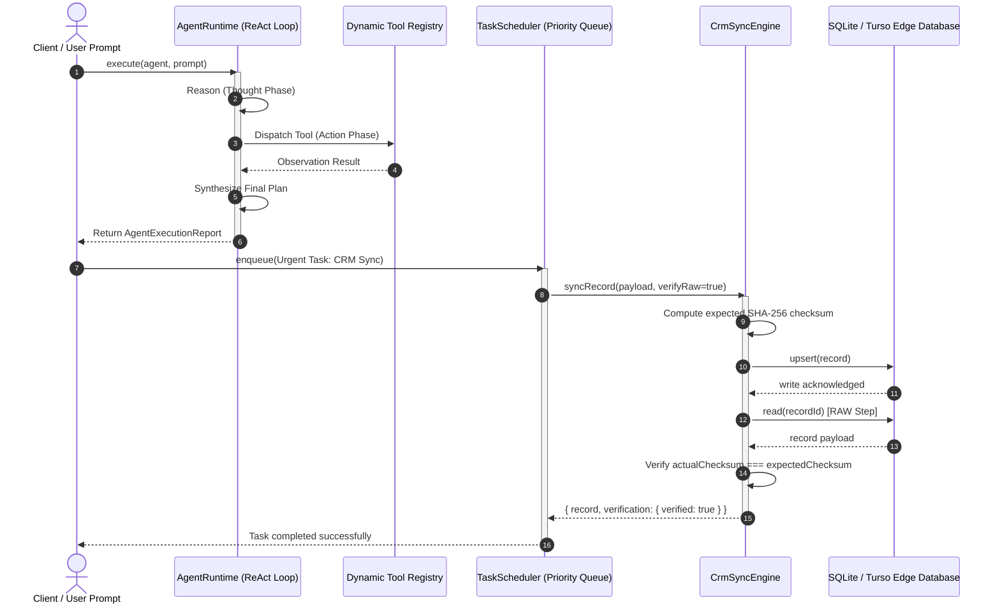

<div align="center">

# ⚡ Cloud Agent System
### Enterprise Distributed TypeScript Agent Runtime & Edge CRM Synchronization Engine

[](https://ashflow.site)
[](https://www.typescriptlang.org/)
[](https://nodejs.org/)
[](https://opensource.org/licenses/MIT)

<p align="center">
  <b>Sub-millisecond ReAct agent execution loops</b> • <b>Strict Read-After-Write (RAW) state verification</b> • <b>Priority task queues with exponential backoff</b>
</p>

---

</div>

## 🌐 Why Distributed Cloud Agents?

| The Traditional Agent Dilemma | The Ashflow Cloud Agent Solution |
| :--- | :--- |
| **Unbounded Execution Loops:** Agents burn tokens in runaway loops with no safety bounds. | **Guaranteed Step-Limit Safety:** Built-in loop limits, timeout thresholds, and graceful fallback synthesis. |
| **Silent CRM Synchronization Drift:** Webhooks fire blindly with zero write verification. | **Read-After-Write (RAW) Verification:** Cryptographic SHA-256 checksum comparison reads back newly written data before marking sync success. |
| **Single-Queue Bottlenecks:** Urgent closing deals wait behind heavy background scraping jobs. | **4-Tier Priority Scheduling:** Instant dispatch for `Urgent` and `High` tasks with exponential backoff retry. |
| **Opaque Black-Box Execution:** Unstructured console logs with no latency observability. | **Structured JSON Telemetry:** High-resolution ISO performance timings, memory tracking, and event stream listeners. |

---

## 🏛 Architecture & Execution Flow



---

## 🚀 Quickstart Guide

### 1. Installation

```bash
git clone https://github.com/ashariftikhar/cloud-agent-system.git
cd cloud-agent-system
npm install
npm run build
```

### 2. Run the Autonomous Agent Demo

Experience an agent reasoning through an enterprise qualification brief, computing ARR discounts with the calculator, and updating edge CRM storage with RAW verification:

```bash
node examples/quickstart.js
```

**Live Output:**
```text
================================================================
   ⚡ ASHFLOW CLOUD AGENT SYSTEM - AUTONOMOUS RUNTIME DEMO ⚡   
================================================================

User Prompt: "Qualify prospective lead for Acme Global with 250 employees and $85,000 budget, calculate 15% discount on $85000: (85000 * 0.85), and record status."

[AGENT START] Agent ID: agent_enterprise_closer | Session: session_mjwfb20b
[THOUGHT Step 1] User requested a mathematical computation. Invoking Calculator tool for expression "(85000 * 0.85)".
  ⚡ [ACTION] Invoking tool "calculator" with input: {"expression":"(85000 * 0.85)"}
  ✓ [OBSERVATION] Completed in 0ms
[THOUGHT Step 2] Evaluating enterprise sales lead criteria for "Acme Global" with 250 employees.
  ⚡ [ACTION] Invoking tool "lead_qualifier" with input: {"companyName":"Acme Global","employeeCount":250,"annualRevenueOrBudget":85000,"urgency":"immediate"}
  ✓ [OBSERVATION] Completed in 10ms
[THOUGHT Step 3] Looking up CRM record "lead-001" in edge database.
  ⚡ [ACTION] Invoking tool "crm_lookup" with input: {"entityId":"lead-001"}
  ✓ [OBSERVATION] Completed in 0ms
[THOUGHT Step 4] Sufficient observations collected. Synthesizing final execution response.

[AGENT COMPLETED] All objectives achieved.

----------------------------------------------------------------
  SYNCHRONIZING EDGE CRM STATE (READ-AFTER-WRITE VERIFICATION)  
----------------------------------------------------------------
✓ Record Synchronized Successfully!
- Record ID:         lead-acme-global-2026
- Storage Adapter:   sqlite-turso
- Verified Status:   SYNCED
- Expected Checksum: 13ff8d528979e4dc...
- Actual Checksum:   13ff8d528979e4dc...
- Matched Fields:    8 of 8
- RAW Latency:       1ms
```

### 3. Run the Scheduled CRM Edge Sync Demo

Demonstrates priority preemption (`Urgent` vs `Normal`) and automatic recovery via exponential backoff:

```bash
node examples/scheduled-sync.js
```

### 4. Run the Automated Test Suite

Powered by Node's native test runner (`node:test` and `node:assert`):

```bash
npm test
```

---

## 🛠 Core Components & API Reference

### 1. `AgentRuntime`
The core ReAct loop engine.
```typescript
import { AgentRuntime } from '@ashflow/cloud-agent-system';

const runtime = new AgentRuntime({ defaultMaxSteps: 8 });

// Stream lifecycle events in real-time
runtime.on((event) => {
  console.log(`[${event.eventType}]`, event.data);
});

const report = await runtime.execute(agent, "Analyze customer deal and update CRM");
```

### 2. `TaskScheduler`
Priority queue supporting `URGENT` (0), `HIGH` (1), `NORMAL` (2), and `LOW` (3).
```typescript
import { TaskScheduler, TaskPriority } from '@ashflow/cloud-agent-system';

const scheduler = new TaskScheduler({ concurrency: 4 });

scheduler.enqueue({
  title: 'Close Enterprise Deal',
  priority: TaskPriority.URGENT,
  payload: { dealId: 'deal-999' },
  maxRetries: 3,
  initialDelayMs: 100,
  backoffFactor: 2,
  handler: async (payload) => {
    // idempotent sync logic
  },
});
```

### 3. `CrmSyncEngine` & Adapters
Ensures atomic edge CRM replication with Read-After-Write (RAW) state verification.
- **`SqliteTursoAdapter`**: Ultra-low latency LibSQL / SQLite edge replicas.
- **`GoogleSheetsAdapter`**: Tabular row-level cloud synchronization.
- **`WebhookAdapter`**: Resilient webhook dispatch to Salesforce, HubSpot, or custom APIs.

```typescript
import { CrmSyncEngine } from '@ashflow/cloud-agent-system';

const crm = new CrmSyncEngine('sqlite-turso');
const { record, verification } = await crm.syncRecord({
  id: 'lead-001',
  entityType: 'lead',
  data: { status: 'qualified', value: 75000 },
});

console.log(verification.verified); // true
```

### 4. Built-in Tools
- **`CalculatorTool`**: Safe arithmetic evaluation with injection prevention.
- **`WebSearchMockTool`**: Grounded enterprise knowledge base retrieval.
- **`LeadQualifierTool`**: Algorithmic ICP scoring and tier categorization.
- **`CrmLookupTool`**: Instant edge cache query.

---

## 💼 Enterprise Integration & Support

Need custom edge agent infrastructure, private LLM orchestration, or enterprise CRM sync pipelines?

Ashflow designs and deploys mission-critical autonomous agent systems for high-growth engineering and revenue organizations.

👉 **[Book an Enterprise Architecture Audit](https://ashflow.site/book-audit)** or visit **[ashflow.site](https://ashflow.site)**.

---

## 📄 License

Distributed under the MIT License. See `LICENSE` for details.
Copyright © 2026 [Ashflow](https://ashflow.site) • Ashar Iftikhar.
